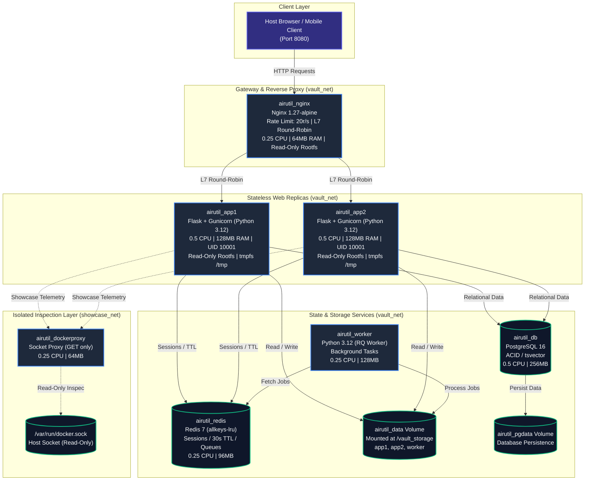

# Airutil ⚡

<div align="center">

[](#-automated-tests--ci-pipeline)
[](#-multi-container-architecture)
[](https://www.python.org/)
[](https://www.postgresql.org/)
[](https://redis.io/)
[-emerald.svg)](tests/)
[](app/static/css/tokens.css)
[](LICENSE)

**Air-drop your files. Lock your logins. Beam anything.**

*A student-friendly, multi-container web application for an Operating Systems course, showcasing Docker containerization, cgroups v2 resource capping, Linux namespaces, OverlayFS, and Layer-7 reverse proxying in action.*

[Quick Start](#-quick-start) • [Architecture](#-multi-container-architecture) • [OS Concepts](#-operating-systems-primitives) • [Phase Reports](docs/phases/) • [Demo Script](docs/DEMO_SCRIPT.md)

</div>

---

## 📖 The Pitch

**Airutil** is an all-in-one productivity vault engineered specifically for university students. It combines an automatic semester file organizer (Smart AirDrop with course code regex matching), an ephemeral AES-128 password vault with an automated 30-second Redis auto-relock mechanism, single-use burn-on-read text beams, and expiring file share links. Built entirely without heavyweight client frameworks, Airutil features a responsive mobile-first UI with custom design tokens, dark/light theme switching, and an integrated **OS Lab & Docker Terminal Showcase** that visualizes the Linux kernel primitives governing the application in real time.

---

## ⚡ Quick Start (3 Commands)

Launch the entire 7-container stack with zero configuration:

```bash
# 1. Clone repository
git clone https://github.com/sundhip/airutil.git && cd airutil

# 2. Configure environment
cp .env.example .env

# 3. Launch stack with Docker Compose
docker compose up -d --build
```

Access the application in your browser at: **[http://localhost:8080](http://localhost:8080)**

---

## 🏗️ Multi-Container Architecture

Airutil is distributed across **7 microservices** connected across two segregated internal Docker bridge networks (`vault_net` and `showcase_net`). Only **port 8080** on Nginx is exposed to the host system.



---

## 🐧 Operating Systems Primitives

Airutil functions as a real-time Operating Systems laboratory. The underlying Docker configuration maps directly to key Linux kernel concepts:

| OS Primitive | Implementation Mechanism | Live Observation Point |
| :--- | :--- | :--- |
| **Control Groups (cgroups v2)** | Capped memory hard limits (`128MB`) and CFS bandwidth quotas (`0.5 CPU`) via Compose `deploy.resources.limits`. | Inspected directly in `/oslab` via `/sys/fs/cgroup/memory.max` and `/sys/fs/cgroup/cpu.max`. |
| **Linux Namespaces** | 8 isolated namespaces per container (`PID`, `NET`, `MNT`, `UTS`, `IPC`, `USER`, `TIME`, `CGROUP`). | Inspected via `/proc/self/ns/*` symlink inodes; PID 1 isolation verified via `docker top`. |
| **OverlayFS vs Volumes** | Union filesystem (`lowerdir`, `upperdir`, `workdir`) mounted read-only (`read_only: true`), contrasted with direct VFS block storage (`airutil_data` volume at `/vault_storage`). | Inspected via `/proc/self/mountinfo`; rootfs write attempts trigger `EROFS` (Read-only file system). |
| **Inter-Process Comm (IPC)** | Ephemeral Redis key broker for session sync across `app1` and `app2`; RQ queue for worker RPC. | 30s vault keys with live decrementing TTLs; atomic single-consumer `GETDEL` operations. |
| **CFS CPU Throttling** | Provoking Linux Completely Fair Scheduler throttling via an interactive CPU stress loop. | `/oslab` telemetry displays rising `nr_throttled` and `throttled_usec` while CPU stays at 50%. |
| **Layer-7 Load Balancing** | Nginx token bucket rate limiter (20r/s) and round-robin upstream traffic distribution. | `X-Served-By` response header alternates 50/50 between `app1:5000` and `app2:5000`. |
| **High Availability** | Automatic reverse proxy failover (`max_fails=3 fail_timeout=10s`). | Pausing `app1` shifts 100% of traffic to `app2` with zero 502/504 errors. |

---

## 📸 Modules & Feature Highlights

### 1. Smart AirDrop & Semester Organizer
- **Interactive Radar Upload**: Drag-and-drop dropzone with animated radar pulses and file type validation.
- **Course Code Detection**: Automatic regex parsing of filenames (`CSE1005_Unit2.pdf` -> automatically tagged with course `CSE1005`).
- **MIME Extension Anti-Spoofing**: Inspects magic bytes to detect disguised Windows PE (`.exe`) and Linux ELF binaries.

```
┌────────────────────────────────────────────────────────┐
│                   [ Smart AirDrop ]                    │
│                        (( 📡 ))                        │
│             Drop course materials here to drop         │
│          Recognized: CSE1005 • Operating Systems       │
└────────────────────────────────────────────────────────┘
```

### 2. Ephemeral Password Vault (30s Redis Unlock)
- **Scrypt & Fernet Encryption**: User master passwords derived with Scrypt (N=2^14, r=8, p=1) and Fernet AES-128-CBC + HMAC-SHA256.
- **30-Second TTL Auto-Lock**: Master key is cached in Redis with `SETEX key 30 ...` and wiped from memory upon expiration.
- **SVG Radial Countdown Ring**: Real-time visual SVG timer displaying the remaining unlock window.

### 3. Burn-on-Read Clip Beam
- **Single-Use Data Transfer**: Text snippet is stored in Redis and atomically retrieved and destroyed using `GETDEL`.
- **PIN-Protected Burning**: Optional 4-digit PIN with a 3-strike burn rule that vaporizes data upon three incorrect attempts.
- **Thermal Burn Animation**: CSS particle burn effect triggering as the beam expires.

### 4. OS Lab & Docker Terminal Showcase
- **Real-Time Telemetry**: 1-second auto-polling gauges for memory current, peak, CPU quota, and throttled cycles.
- **In-Browser Terminal**: Powered by vendored `xterm.js` and Server-Sent Events (SSE) with strict command whitelist validation.
- **13 Automated Proofs**: Runs live validation of cgroups, namespace inodes, OverlayFS mounts, and upstream balancing.

---

## 💻 Tech Stack

- **Containerization**: Docker Compose v2, Alpine Linux, Debian Bookworm Slim, `tecnativa/docker-socket-proxy`.
- **Reverse Proxy**: Nginx 1.27 (Layer-7 load balancer, token-bucket rate limiter, unbuffered SSE).
- **Backend**: Python 3.12, Flask 3.1, Gunicorn 23.0 (pre-fork worker model), RQ 2.1 (Redis Queue).
- **Database**: PostgreSQL 16 (ACID transactions, `tsvector` full-text search, composite indexes).
- **In-Memory Cache**: Redis 7 (`allkeys-lru` eviction, volatile TTL keys, atomic `GETDEL`).
- **Frontend**: Vanilla HTML5, CSS3 with Design Tokens, ES6+ JavaScript, `xterm.js` v5.3.0 (zero heavy JS dependencies).
- **Security & Crypto**: `argon2-cffi` (Argon2id password hashing), `cryptography` (Fernet & Scrypt), CSRF double-submit cookies.

---

## 🔒 Security Hardening Matrix

| Security Layer | Hardening Mechanism | Impact / Protection |
| :--- | :--- | :--- |
| **Root Filesystem** | `read_only: true` on `app1`, `app2`, `worker`, `nginx` | Prevents file tampering and binary execution in `/bin`, `/usr`, or app roots. |
| **Process Identity** | Non-root `UID 10001` (`airutil`) | Mitigates container escape attacks by running as an unprivileged user. |
| **Capabilities** | `cap_drop: [ALL]` | Removes all Linux kernel capabilities (prevents raw sockets, chown escalation). |
| **Process Caps** | `pids_limit: 100` | Prevents denial-of-service attacks via fork bombs (`:(){ :\|:& };:`). |
| **Docker Socket** | Read-only proxy on isolated `showcase_net` | Restricts API to non-mutating `GET` requests; prevents unauthorized container spawns. |
| **Database Access** | Parameterized queries via `psycopg2` | 100% immune to SQL injection attacks; no string concatenation in queries. |
| **Secrets Engine** | Fail-fast validator (`validate_production_secrets`) | Blocks deployment with placeholder keys, default passwords, or short secrets. |

---

## 🧪 Acceptance Checks & Testing

Airutil includes a comprehensive test and validation suite:

```bash
# 1. Run full Pytest test suite (52 tests across all modules)
make test
# Output: 52 passed in 17.77s

# 2. Run OS & Docker primitives verification (10 checks)
make verify-os
# Output: ALL OS PRIMITIVE VERIFICATIONS PASSED! (0 errors)

# 3. Run Layer-7 upstream load distribution test (50 requests)
make load-test
# Output: app1: 25 (50%), app2: 25 (50%), Failed: 0

# 4. Run the 13 automated OS & Docker proofs
make showcase-auto
# Output: All 13 OS and Docker architectural proofs successfully completed!

# 5. Create disaster recovery backup
make backup
# Output: Transactional backup created with SHA256SUMS

# 6. Test disaster recovery restore
make restore
# Output: Relational database & shared volume restored (10001:10001)
```

---

## 📚 Project Documentation

Detailed architecture reports and coursework assets are available in the repository:
- **[System Architecture](docs/ARCHITECTURE.md)**: Deep dive into container roles, data flows, and design trade-offs.
- **[Operating Systems Concepts](docs/OS_CONCEPTS.md)**: Educational student guide mapping code to Linux kernel primitives.
- **[Video Demo Script](docs/DEMO_SCRIPT.md)**: Timestamped 6-to-8 minute video presentation walkthrough.
- **[Academic Report Outline](docs/REPORT_OUTLINE.md)**: Formal coursework project report skeleton (DA-3 format).
- **[Portfolio & Resume Bullets](docs/LINKEDIN.md)**: LinkedIn post and measurable resume bullet points.
- **[Security Threat Model](docs/SECURITY.md)**: STRIDE analysis and vulnerability audit report.
- **[Phase Reports](docs/phases/)**: Complete engineering reports for Phases 1 through 10.

---

## 📄 License

This project is licensed under the MIT License - see the [LICENSE](LICENSE) file for details. Created for Operating Systems coursework and portfolio demonstration.
