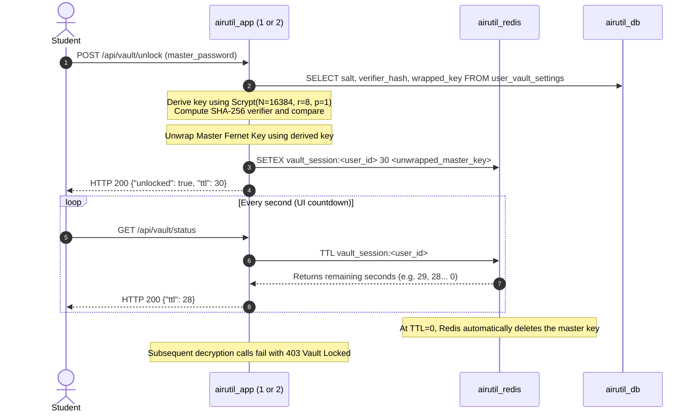

# Airutil System Architecture & Engineering Design

**Project**: Airutil (*"Air-drop your files. Lock your logins. Beam anything."*)  
**Context**: Operating Systems Coursework & Portfolio-Grade Production System  
**Author**: Lead Systems Engineer  

---

## 1. Architectural Philosophy & Overview

Airutil is designed around a core Operating Systems principle: **defense-in-depth through kernel-level isolation, stateless execution replicas, and bounded ephemeral state**.

Modern web architectures often delegate security and resource governance entirely to cloud providers or application frameworks. Airutil deliberately implements these constraints at the **Linux kernel boundary** using Docker Compose v2, cgroups v2, network namespaces, union filesystems (OverlayFS), and POSIX storage primitives.

```
                            [ Host Browser / Mobile ]
                                        │
                                :8080 (TCP / HTTP)
                                        ▼
                             ┌─────────────────────┐
                             │    airutil_nginx    │
                             │ (Reverse Proxy/L7)  │
                             └──────────┬──────────┘
                                        │
                   ┌────────────────────┴────────────────────┐  vault_net (172.20.0.0/16)
                   ▼                                         ▼
        ┌─────────────────────┐                   ┌─────────────────────┐
        │    airutil_app1     │                   │    airutil_app2     │
        │  (Flask + Gunicorn) │                   │  (Flask + Gunicorn) │
        └──────────┬──────────┘                   └──────────┬──────────┘
                   │                                         │
                   ├────────────────────┬────────────────────┤
                   ▼                    ▼                    ▼
        ┌─────────────────────┐ ┌───────────────┐ ┌─────────────────────┐
        │    airutil_redis    │ │  airutil_db   │ │   airutil_worker    │
        │   (In-Memory Cache) │ │ (Postgres 16) │ │    (RQ Worker)      │
        └─────────────────────┘ └───────────────┘ └─────────────────────┘
                   │
                   └──────────────┐ showcase_net (172.21.0.0/16)
                                  ▼
                       ┌─────────────────────┐
                       │ airutil_dockerproxy │ (Read-Only Docker Socket Proxy)
                       └─────────────────────┘
```

---

## 2. Microservice Roles & Runtime Contracts

Airutil comprises **7 specialized microservices**, each constrained by strict memory caps, CPU quotas, user permissions, and network access policies:

| Container | Base Image | Network | Memory Limit | CPU Limit | User (UID:GID) | Rootfs | Primary Responsibility |
| :--- | :--- | :--- | :---: | :---: | :---: | :---: | :--- |
| `airutil_nginx` | `nginx:1.27-alpine` | `vault_net` | 64 MiB | 0.25 | 101:101 | `read_only` | Public gateway, SSL termination point, token-bucket rate limiter, unbuffered SSE transport, and upstream round-robin load balancer. |
| `airutil_app1` | Python 3.12-slim | `vault_net`<br>`showcase_net` | 128 MiB | 0.50 | 10001:10001 | `read_only` | Stateless web worker replica 1. Runs Gunicorn with 2 sync worker processes serving HTTP requests. |
| `airutil_app2` | Python 3.12-slim | `vault_net`<br>`showcase_net` | 128 MiB | 0.50 | 10001:10001 | `read_only` | Stateless web worker replica 2. Identical clone of `app1` providing active-active high availability. |
| `airutil_worker` | Python 3.12-slim | `vault_net` | 128 MiB | 0.25 | 10001:10001 | `read_only` | Asynchronous job consumer running Python RQ (Redis Queue) for background thumbnail generation, file integrity scans, and cleanup tasks. |
| `airutil_redis` | `redis:7-alpine` | `vault_net` | 96 MiB | 0.25 | 999:999 | `read_only` | Ephemeral high-speed storage broker. Manages user sessions, 30s vault keys, burn-on-read clips, rate limit state, and RQ queues. Disk persistence disabled (`allkeys-lru`). |
| `airutil_db` | `postgres:16-alpine` | `vault_net` | 256 MiB | 0.50 | 70:70 | Read/Write | Relational persistence engine. Manages user credentials, course catalogs, metadata, full-text indexes (`tsvector`), and audit logs. |
| `airutil_dockerproxy`| `tecnativa/docker-socket-proxy` | `showcase_net` | 64 MiB | 0.25 | 0:0 (internal) | Read/Write | Read-only security boundary for Docker daemon introspection. Accepts only `GET` requests from `app1` and `app2`. Isolated from public traffic. |

---

## 3. End-to-End Module Data Flows

### Module 1: Accounts & Session Management
```mermaid
sequenceDiagram
    autonumber
    actor Student as Student Browser
    participant Nginx as airutil_nginx
    participant App as airutil_app1 / app2
    participant Redis as airutil_redis
    participant DB as airutil_db

    Student->>Nginx: POST /login (username, password, csrf_token)
    Nginx->>App: Forward via Round-Robin
    App->>DB: SELECT id, password_hash FROM users WHERE username = ?
    DB-->>App: Return user row
    Note over App: Verify Argon2id hash (argon2-cffi)
    App->>Redis: SETEX session:<uuid> 86400 (user_id, username, email)
    App-->>Nginx: Set-Cookie: airutil_session=<uuid>; HttpOnly; SameSite=Lax
    Nginx-->>Student: 302 Redirect to /dashboard
```

### Module 2: Smart AirDrop & Semester File Storage
1. **Intake & Dropzone**: Student drops a file into the animated radar zone on `POST /api/files/upload`.
2. **Magic Byte Inspection**: The application inspects the first 512 bytes using `python-magic` / file signatures to verify the true MIME type. If an executable binary (e.g. Windows PE `MZ` header or Linux ELF `\x7fELF`) is disguised as a `.pdf` or `.docx`, the request is immediately rejected with HTTP 400.
3. **Course Code Regex Extraction**: Filenames are evaluated against institutional course code patterns:
   $$\text{Pattern} = \text{\textbackslash b}([A-Z]{2,4}[0-9]{3,4}[A-Z0-9]?)\text{\textbackslash b}$$
   Matches (e.g. `CSE1005`, `BCSE201P`, `MAT2001`) automatically associate the file with the student's registered semester course catalog.
4. **POSIX Atomic Write**: Files are streamed into the shared volume mount:
   $$\text{Path} = \text{/vault\_storage/files/\{user\_id\}/\{category\}/\{course\}/\{uuid\}\_\{sanitized\_filename\}}$$
5. **Database Transaction**: PostgreSQL inserts the file metadata, size, SHA-256 checksum, and generated search tsvectors in a single ACID transaction.

### Module 3: AES-128 Password Vault with 30s Redis Ephemeral Key


### Module 4: Burn-on-Read Clip Beam (Atomic GETDEL)
The Clip Beam module guarantees true zero-knowledge, single-consumer transfer of ephemeral snippets:
1. **Creation**: Student posts text snippet, TTL (1m, 1h, 24h), and optional 4-digit PIN.
2. **Payload Validation**: Hard limit enforced at $\le 64\text{ KB}$ to prevent Redis memory exhaustion.
3. **Storage**: Stored via `SETEX beam:<token> <ttl_seconds> <json_payload>`.
4. **Consumption**: When retrieved, the server executes Redis command `GETDEL beam:<token>`:
   - If no PIN is configured, `GETDEL` atomically returns the content and deletes the key in $O(1)$ time within the Redis single-threaded execution loop. No subsequent requests can ever read it again.
   - If a PIN is configured, wrong guesses increment `beam:pin_attempts:<token>`. Upon the 3rd failed strike, the server executes `DEL beam:<token>` to incinerate the snippet immediately.

### Module 5: Expiring Share Links
1. **Generation**: Cryptographically random 32-character hex token generated via `secrets.token_hex(16)`.
2. **Access Control**: Stored in PostgreSQL `share_links` table with `expires_at`, `max_downloads`, and `access_count`.
3. **Enforcement**: Upon `GET /share/<token>`, the server verifies:
   $$\text{NOW}() < \text{expires\_at} \quad \land \quad (\text{max\_downloads IS NULL} \lor \text{access\_count} < \text{max\_downloads})$$
4. If valid, the file is streamed via HTTP chunking directly from `/vault_storage`. Once expired or exhausted, the endpoint returns HTTP 410 Gone.

### Module 6: OS Lab & Kernel Introspection
1. **Sysfs & Procfs Readers**: Web replicas read `/sys/fs/cgroup/memory.*`, `/sys/fs/cgroup/cpu.*`, `/proc/self/ns/*`, and `/proc/self/mountinfo`.
2. **Zero Escapes**: Introspection runs entirely within the unprivileged container namespace using read-only filesystem mounts. No root permissions or daemon socket mounts are required.
3. **CFS Stress Provoker**: The interactive 10s CPU stress test provokes Linux Completely Fair Scheduler throttling. A Redis mutex lock (`oslab_stress_lock`, `NX`, 12s TTL) guarantees single-tenant execution, returning HTTP 429 to concurrent requests.

### Module 7: Docker Terminal Showcase
```mermaid
sequenceDiagram
    autonumber
    actor Admin as Admin Browser
    participant Nginx as airutil_nginx
    participant App as airutil_app1 / app2
    participant Proxy as airutil_dockerproxy
    participant Daemon as Host Docker Daemon

    Admin->>Nginx: GET /api/terminal/run?cmd=docker+ps
    Note over Nginx: proxy_buffering off;<br/>chunked_transfer_encoding on;
    Nginx->>App: Forward request
    Note over App: CommandWhitelistParser.validate("docker ps")<br/>Reject any |, ;, &, $(), >, <
    App->>Proxy: GET /containers/json
    Proxy->>Daemon: GET /var/run/docker.sock/containers/json
    Daemon-->>Proxy: JSON container array
    Proxy-->>App: Filtered JSON
    App-->>Nginx: Stream formatted text via SSE (text/event-stream)
    Nginx-->>Admin: Real-time characters rendered in xterm.js
```

---

## 4. Deep-Dive: Technology Choices & Trade-Offs

### 4.1 Why Redis?
- **Sub-Millisecond In-Memory Ephemeral Storage**: User authentication sessions, rate limit counters, and temporary 30-second vault unlock keys do not belong in relational disk storage. Redis provides $O(1)$ read and write performance completely in memory.
- **Native Ephemeral Key Eviction (`TTL` / `SETEX`)**: Redis offloads TTL tracking to the engine level. Expired keys are automatically purged via active and passive expiration algorithms without requiring cron workers or background database polling loops.
- **Atomic Primitives (`GETDEL`, `INCR`, `SET NX EX`)**:
  - `GETDEL` provides race-free burn-on-read semantics: the snippet is returned and deleted in one atomic operation. Two concurrent HTTP requests cannot both retrieve the snippet.
  - `SET ... NX EX` implements distributed mutual exclusion (mutex locks) for the OS Lab stress testing provoker.
- **Memory Capping & LRU Eviction**: Configured with `maxmemory 64mb` and `maxmemory-policy allkeys-lru`. If memory pressure spikes, the oldest session keys are safely dropped rather than crashing the container.

### 4.2 Why PostgreSQL?
- **ACID Transactions**: Financial-grade consistency for user accounts, file ownership records, and course catalogs.
- **Relational Integrity & Foreign Keys**: Guarantees that deleting a student cleanly cascades to their file metadata, vault settings, and share links (`ON DELETE CASCADE`).
- **Built-In Full-Text Search (`tsvector` & `tsquery`)**:
  Instead of deploying a separate, memory-intensive Elasticsearch or Meilisearch cluster, Airutil utilizes PostgreSQL's native GIN-indexed `tsvector` column:
  ```sql
  CREATE INDEX idx_files_search_vector ON files USING gin(search_vector);
  ```
  This delivers instant, zero-dependency fuzzy search across filenames, course descriptions, and file categories.

### 4.3 Why a Shared Named Volume (`airutil_data`)?
- **Independent Stateless Web Replicas**: `app1` and `app2` run as ephemeral containers. Any file uploaded via `app1` must be immediately readable by `app2` without complex network file replication or S3 latency.
- **Direct POSIX Filesystem Performance**: Named volumes map directly to the host storage system without going through user-space virtualization layers. Writes achieve raw disk speeds while allowing the background `worker` process to process file thumbnails asynchronously.
- **Decoupled Lifecycle**: The application containers can be stopped, rebuilt, upgraded, or replaced without affecting stored files.

---

## 5. Architectural Trade-offs & Limitations

1. **Single-Host Orchestration Boundary**:
   - *Current*: Docker Compose manages all 7 containers on a single Linux host.
   - *Trade-off*: Zero network latency between containers and trivial local development, but bounded by the physical CPU, memory, and disk I/O of a single host.
   - *Production Evolution*: In a multi-host enterprise deployment, the architecture would transition to Kubernetes (K8s) or Nomad, replacing named volumes with distributed Ceph/NFS or cloud object storage (S3/GCS).
2. **Shared Volume File Concurrency**:
   - *Current*: Both `app1` and `app2` write directly to `/vault_storage`.
   - *Mitigation*: Collisions are eliminated by appending UUIDv4 prefixes to stored filenames (`{uuid}_{sanitized_name}`) and recording metadata in PostgreSQL before writing.
3. **Socket Proxy Access Scope**:
   - *Current*: `airutil_dockerproxy` is restricted to non-mutating `GET` requests on an isolated internal network (`showcase_net`).
   - *Security Defense*: Even if an attacker compromised `app1`, the socket proxy rejects any attempts to create containers, mount new volumes, or execute shell commands on the host.

---

## 6. Summary

Airutil demonstrates that production-grade architecture does not require heavyweight distributed microservice stacks. By leveraging native Linux kernel boundaries (cgroups v2, namespaces, OverlayFS) and carefully matched backing services (Redis for ephemeral state, PostgreSQL for relational ACID state, Nginx for L7 routing), Airutil delivers enterprise security, measurable resilience, and sub-millisecond responsiveness within a strictly capped 1.75 CPU and 768MB RAM footprint.
